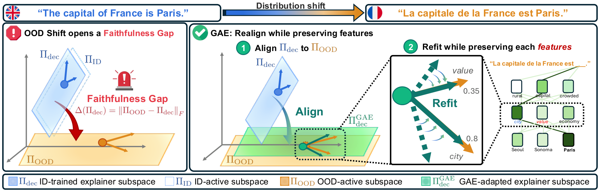

# Geometry-Adaptive Explainer (GAE)

Official implementation of **Geometry-Adaptive Explainer for Faithful Dictionary-Based Interpretability under Distribution Shift** (**NeurIPS 2026**).

👥 **Authors:** [Sungjun Lim](https://sungjun98.github.io/), Heedong Kim, [Andrew Lee](https://ajyl.github.io/about)\*, [Kyungwoo Song](https://mlai.yonsei.ac.kr/)\*.
\* Corresponding authors.

[📄 Paper](https://arxiv.org/abs/2605.21849) · [🌐 Project page & interactive analysis](https://sungjun98.github.io/projects/gae/)

[](LICENSE)


[🔍 Overview](#-overview) · [🔬 Method](#-method) · [🚀 Installation & usage](#-installation--usage) · [📊 Main results](#-main-results) · [📁 Code layout](#-code-layout) · [📚 Citation](#-citation)

## 🔍 Overview

**Restore explanation faithfulness under distribution shift without gradient updates.**

Dictionary-based explainers, including sparse autoencoders (SAEs) and transcoders, learn feature directions from in-distribution (ID) activations.
Distribution shift can move the model's active subspace away from these directions, making the original dictionary geometrically misaligned with out-of-distribution (OOD) activations.
We formalize this mismatch as the **faithfulness gap** and relate it to excess OOD projection loss.

<p align="center">
  
</p>

**GAE adapts the decoder using only unlabeled OOD activations.**
It keeps the encoder fixed, so the same input retains the same feature indices, activation values, and sparsity pattern.
The decoder directions change to better explain the shifted model activations.

- **Diagnosis:** identify geometric misalignment and bound excess projection loss through the faithfulness gap.
- **Method:** align the dictionary and refit the decoder with closed-form linear algebra.
- **Evidence:** improve causal faithfulness across temporal, domain, and adversarial shifts with a small OOD activation pool.

## 🔬 Method

GAE takes an ID-trained dictionary explainer and unlabeled OOD activations, and returns an adapted decoder and bias.
The encoder remains fixed throughout both steps.

1. **Align the dictionary subspace.**
   Estimate the OOD-active subspace and use an orthogonal Procrustes update to align the dictionary with it.
2. **Refit the decoder.**
   Solve a geometry-regularized affine ridge problem using the original encoder features, balancing OOD reconstruction with proximity to the original and aligned dictionaries.

The two steps are implemented in [`gae.py`](gae.py) as `gae_torch` and `fit_affine_constrained_decoder`.
`gae_torch` performs the alignment step; use the decoder refit as well to obtain the complete adaptation shown below.

## 🚀 Installation & usage

Use Python 3.10 or newer.
The core functions in `gae.py` require PyTorch and NumPy:

```bash
git clone https://github.com/MLAI-Yonsei/GAE.git
cd GAE
python -m pip install torch==2.8.0 numpy==1.26.4
```

The model and dataset integration dependencies are listed in [`requirements.txt`](requirements.txt).

### 🧩 Adapt an existing SAE

Start with your trained SAE, its ID decoder dictionary, and a small pool of unlabeled OOD activations.
For this example, use a CPU explainer and float32 CPU tensors.
The explainer must support `explainer(h, return_z=True)`, returning `(reconstruction, features)` with features of shape `[N, k]`.

| Input | Shape | Meaning |
|---|---|---|
| `explainer` | Callable | Your trained SAE with its original encoder |
| `B_id` | `[d, k]` | ID decoder dictionary; each column is one feature direction |
| `H_ood` | `[N, d]` | Unlabeled OOD hidden activations |

If your library stores decoder weights as `[k, d]`, transpose them to obtain `B_id`.
Choose a subspace rank `r` no larger than `min(d, k, N - 1)`; the example uses `r = 64`.

```python
import torch
from gae import gae_torch, fit_affine_constrained_decoder

# Supply your trained explainer, B_id [d, k], and H_ood [N, d].
explainer.eval()

# Step 1: align the ID dictionary to the OOD-active subspace.
B_aligned, geometry = gae_torch(B_id, H_ood, r=64)

# Step 2: refit only the decoder, using the unchanged encoder.
D_gae, b_gae, fit_info = fit_affine_constrained_decoder(
    explainer=explainer,
    activations_in=H_ood,
    activations_target=H_ood,
    B_original=B_id,
    B_gae=B_aligned,
    U_ood=geometry["U_ood"],
    fit_samples=2048,
)

# Reconstruct OOD activations with the original features and adapted decoder.
with torch.no_grad():
    _, z = explainer(H_ood, return_z=True)
    H_hat = z @ D_gae.T + b_gae
```

`D_gae` has shape `[d, k]`, `b_gae` has shape `[d]`, and `H_hat` has shape `[N, d]`.
`geometry` contains the subspace bases and rotation; `fit_info` contains decoder-fit diagnostics, including `fit_mse`.
Use `D_gae` and `b_gae` for decoding while continuing to use the original encoder for feature extraction.

For a **transcoder**, `activations_in` contains the encoder-input activations and `activations_target` contains the corresponding decoder-output targets.
Pass these output targets to `gae_torch` to estimate geometry in the same space as the decoder dictionary.
The rank, fitting sample count, and regularization strengths are arguments of the two functions; see their docstrings in [`gae.py`](gae.py).

## ➕ GAE+ (branch `gae+`)

GAE+ decides how much of GAE's Step 1 and Step 2 change to apply, so that the adapted decoder is not worse than the original with high probability.
With `A = [W, b]` (decoder and bias, shape `[d, k+1]`):

```
A_plus = A0 + eta1 (A1 - A0) + eta2 (A2 - A1),   0 <= eta2 <= eta1 <= 1
A0 = original decoder,  A1 = after Step 1,  A2 = after Step 2 (lambda_id = 0)
```

`eta` minimizes the change in held-out reconstruction error plus an uncertainty penalty with failure probability `delta`.
`eta = (0, 0)` keeps the original decoder and `eta = (1, 1)` is plain GAE.

### Procedure

1. Split the OOD activations into halves A and B.
2. Build `A0, A1, A2` on half A (`gae_plus_probe.build_candidates`).
3. Select `eta` on half B (`gae_plus.gae_plus_select`).

```python
from gae_plus import gae_plus_select
from gae_plus_probe import build_candidates, encode

A0, A1, A2, _ = build_candidates(explainer, model, layer, id_in, id_out,
                                 ood_in[idx_a], ood_out[idx_a], r=32)
Z, _ = encode(explainer, ood_in[idx_b])          # features [n, k], float64
Y = ood_out[idx_b].double()                      # targets  [n, d]
eta1, eta2, A_plus = gae_plus_select(Z, Y, A0, A1, A2)   # mode="elementwise", bound="best", delta=0.05
W_plus, b_plus = A_plus[:, :-1], A_plus[:, -1]
```

`Z` and `Y` must not overlap with the samples used to build `A1` and `A2`.

### Options of `gae_plus_select`

| Argument | Value | Meaning |
|---|---|---|
| `mode` | **`elementwise`** (default) | Separate bound per entry of `H` (2×2) and `g` (2), Bonferroni over 5 entries, basis `(A1 − A0, A2 − A0)` |
| | `tie` | `eta1 = eta2`, i.e. `A_plus = A0 + t (A2 − A0)` |
| | `matrix` | Free `eta`, one operator-norm bound on `H` and one on `g` (basis `(A1 − A0, A2 − A1)`) |
| `bound` | **`best`** (default) | Smaller of `chebyshev` and `bernstein` |
| | `bernstein` | `H`: Tropp matrix Bernstein (2015, Thm 1.6.2); `g`: Pinelis dimension-free Bernstein (1994, Thm 3.4) |
| | `chebyshev` | Chebyshev, radius `s / sqrt(n · delta)` |
| `delta` | `0.05` | Failure probability (95% guarantee) |

Ranges `s` are the observed maxima on half B, so the guarantee is not strict.

### Reproducing the original plan

The original plan (no sample split, uniform bounds `a_N ||D||_F^2 + 2 b_N ||D||_F`) is kept as separate functions:
`eta_objective_terms` → `compute_bounds(Z, E0, delta, method)` → `select_eta(H, g, K, a_N, b_N)`.
`method` is `"A"` (Tropp ambient Bernstein), `"chebyshev"` (`c = sqrt(2 / (N delta))`), `"B"` (Wang–Ramdas empirical Bernstein), `"bernstein"`, or `"best"` (default).
`gae_plus_bounds_grid.py --split off` runs this path.

### Environment and data

Every script is self-contained: settings at the top, paths overridable by env (`DATA_ROOT`, `CACHE_ROOT`).
Each one creates the environment (`uv venv --python 3.10 && uv pip sync requirements.lock`) and writes `run_info.txt`, `uncommitted.diff` and a copy of itself to `results/gae_plus/<run>/`.

```bash
bash scripts/data/download_owt_subset.sh              # OpenWebText shards 0-1 (train) and 79 (held-out ID), pinned + sha256
bash scripts/train_id/train_gpt2_transcoder.sh [GPU]  # GPT-2 Small transcoder, paper setting (~1 h on A6000)
bash scripts/gae_plus/build_edgar_prompts.sh          # Edgar prompts, pinned revision
```

### Experiments (`scripts/gae_plus/`, usage `bash <script> [GPU]`)

| Script | What it does |
|---|---|
| `bounds_grid.sh` | Main GAE+ grid on HaluEval: split off/on × free/tie × none/chebyshev/best, plus elementwise; scored on 1,000 held-out activations |
| `probe_bounds.sh` | Original plan's `a_N`, `b_N` (methods A, B) and selected `eta` |
| `split_check.sh` | In-sample vs held-out error of `A0, A1, A2` |
| `reproduce_gpt2_halueval.sh` | Table 2 reproduction, HaluEval |
| `reproduce_gpt2_edgar.sh` | Table 2 reproduction, Edgar (code defaults) |
| `reproduce_gpt2_edgar_paper.sh` | Edgar with paper settings (`second_moment`, `lambda_id = 0`) |
| `reproduce_gpt2_edgar_paper_nonorm.sh` | Same, without Step 1 column-norm matching |

### New environment options (defaults keep the original behavior)

| Variable | Default | Alternative |
|---|---|---|
| `GAE_SUBSPACE_MATRIX` | `centered` (covariance) | `second_moment` (paper Eq. 5) |
| `GAE_STEP1_MATCH_NORMS` | `1` (rescale aligned columns to original norms) | `0` |
| `GAE_AC_LAMBDA_ID` | `5e-2` | `0` (used by all GAE+ scripts) |
| `DOMAIN_EVAL_DISJOINT` | `0` | `1`: domain eval prompts disjoint from the GAE fit prompts |
| `GAE_ID_DATA_FILES` | unset (Hub download) | comma-separated local parquet shards for GPT-2 ID data |

### Tests

```bash
python tests/test_gae_plus.py      # 27 checks: objective, bounds coverage, selection, options
python tests/test_gae_options.py   # GAE_SUBSPACE_MATRIX option
```

### Known issues (not fixed)

- HaluEval: only 175 evaluation prompts are produced (sampling of 1.2× n before split filtering), and the `dialogue_history` field is not read, so only QA samples are used.

## 📊 Main results

Representative **GPT-2 Small transcoder** results reported in the paper are shown below.
The metric is **nComp ↑**, the normalized logit drop after ablating the top 32 features.
SAEBoost is the strongest training-based baseline on this metric in these three settings.

| Distribution shift | Dataset | Fixed | SAEBoost | GAE |
|---|---|---:|---:|---:|
| Temporal | FineWeb | 1.017 | 1.476 | **1.494** |
| Domain | Edgar | 1.025 | 1.542 | **1.618** |
| Adversarial | HaluEval | 0.737 | 0.921 | **0.963** |

### ⚡ Adaptation cost

| Method | OOD budget | GPT-2 | Pythia-1.4B |
|---|---|---:|---:|
| Finetune | 5M tokens | ~2 min | ~12 min |
| Retrain | 100M tokens | ~39 min | ~4 hrs |
| **GAE** | **~2K activation vectors** | **0.5 s** | **2.9 s** |

These are reported adaptation timings, rather than end-to-end experiment runtimes.
See the [paper](https://arxiv.org/abs/2605.21849) for the full SAE and transcoder comparisons, additional models, metrics, and analysis, or explore the [project page](https://sungjun98.github.io/projects/gae/) for interactive results and qualitative examples.

## 📁 Code layout

| File / directory | Role |
|---|---|
| [`gae.py`](gae.py) | GAE alignment, decoder refitting, and dictionary utilities |
| [`gae_plus.py`](gae_plus.py) | GAE+ objective, bounds, and `eta` selection |
| [`gae_plus_probe.py`](gae_plus_probe.py), [`gae_plus_bounds_grid.py`](gae_plus_bounds_grid.py), [`gae_plus_split_check.py`](gae_plus_split_check.py) | GAE+ experiment drivers |
| [`config.py`](config.py) | Model settings and adaptation defaults |
| [`utils.py`](utils.py) | Explainer wrappers, model loading, and activation utilities |
| [`run_experiment.py`](run_experiment.py) | Integration with OOD datasets and evaluation |
| [`ood_utils/`](ood_utils/) | Dataset loaders and faithfulness metrics |
| [`train_explainers.py`](train_explainers.py), [`sae_training/`](sae_training/) | Supporting explainer-training utilities |
| [`saeboost.py`](saeboost.py) | SAEBoost baseline |
| [`scripts/`](scripts/) | Supporting experiment launchers |
| [`assets/`](assets/) | Figures used in this README |

## 📚 Citation

If you use GAE in your research, please cite:

```bibtex
@inproceedings{lim2026gae,
  title = {Geometry-Adaptive Explainer for Faithful Dictionary-Based Interpretability under Distribution Shift},
  author = {Lim, Sungjun and Kim, Heedong and Lee, Andrew and Song, Kyungwoo},
  booktitle = {Advances in Neural Information Processing Systems},
  year = {2026},
  url = {https://arxiv.org/abs/2605.21849}
}
```

## 📬 Contact

For questions, open a [GitHub issue](https://github.com/MLAI-Yonsei/GAE/issues) or contact Sungjun Lim at `lsj9862@gmail.com`.

## 📄 License

This code is released under the [Apache 2.0 License](LICENSE).

## 🙏 Acknowledgements

We thank the maintainers of [TransformerLens](https://github.com/TransformerLensOrg/TransformerLens) and [SAELens](https://github.com/jbloomAus/SAELens), on which the model integration utilities depend.
